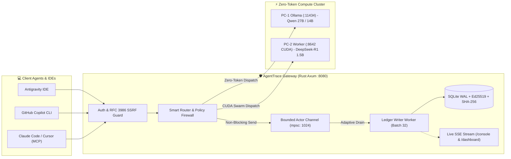

# 🌐 AgentTrace Gateway (`agent_trace_gw`)

[](LICENSE)
[](https://www.rust-lang.org/)
[](tests/)
[](src/ledger.rs)
[-blueviolet.svg)](src/ledger_writer.rs)
[](src/agent_interface/mcp.rs)

> **High-throughput, sub-5ms cryptographic audit ledger, actor-based reverse proxy, and multi-agent governance gateway in pure Rust.**  
> Built for autonomous agent clusters running tools, shell commands, file diffs, and local/remote LLM inferences.

---

## 🎯 Why AgentTrace? The 5 Real-World Scenarios That Sell The App

Autonomous AI coding agents (GitHub Copilot CLI, Hermes Agent, Antigravity, Claude Code) are rapidly being granted terminal access, shell execution, and write permissions across codebases. **Operating them without a cryptographic proxy is like driving without a seatbelt.**

AgentTrace was built to solve the real dangers of autonomous agent deployment, demonstrated live through the **Terminal Console (`/console`)** and **Visual Dashboard (`/dashboard`)**:

| # | Real-World Danger & Question | Why Standard Tools Fail | The AgentTrace Solution | Live UI Demonstration |
|---|:---|:---|:---|:---|
| **1** | **Secret & Sensitive Path Intrusion**<br>*"Did an agent read or leak `.env`, `id_rsa`, or AWS credentials?"* | `git status` only tracks committed files. Agents crawling directories silently inject secrets into prompt contexts. | In-memory **Policy Engine** intercepts path access at the gateway. Matches against blocked patterns and marks `verdict:Blocked` with 0 blast radius. | Click **`[1. 🛡️ Intercept .env Leak]`** in UI or press <kbd>B</kbd>. Alert flashes red, isolates path, and displays rule match. |
| **2** | **In-Flight Code Modification Forensics**<br>*"What exact code did the agent change in my project?"* | Standard logs lose context when stdout redirects. You only see changes post-commit, masking hallucinations. | Captures in-flight **Unified Diffs** before disk sync or git commit, recording additions and deletions in the immutable ledger. | Click **`[2. 📝 In-Flight Code Diff]`** or press <kbd>D</kbd>. Inspector renders colorized git diff (`+` green, `-` red). |
| **3** | **Zero-Token Cost & Code Leakage Prevention**<br>*"Did my proprietary code leak to paid commercial APIs?"* | Standard HTTP proxies cannot classify prompt semantics or enforce cost circuit breakers. | **Zero-Token Router** classifies intent and auto-delegates prompts to local Ollama (`qwen3.8:27b`) or cluster workers (`deepseek-r1:1.5b`) at **$0 token cost**. | Click **`[3. 🔀 Zero-Token Route]`**. Shows original model intercepted, local destination, latency ms, and tokens saved. |
| **4** | **1-Keystroke Proof of Non-Tampering**<br>*"Can I mathematically prove logs have not been altered?"* | Traditional SQLite rows and text logs can be edited or deleted by attackers or rogue scripts with disk access. | Every event is chained with **SHA-256** and signed with **Ed25519**. Over **11,600+ blocks** mathematically verified in milliseconds. | Click **`[4. ⛓️ Cryptographic Proof]`** or press <kbd>V</kbd>. Headless verifier checks hash continuity across all blocks. |
| **5** | **Instant Runtime Agent Sandboxing**<br>*"An agent is stuck in an infinite loop. How do I freeze it?"* | Killing the gateway drops IDE sessions and kills active streams. Standard watchdogs take seconds to kick in. | **Runtime Policy Gate** injects in-memory restrictions (`StrictSandbox`) instantly, halting destructive actions without server restart. | Click **`[5. 🛑 Runtime Sandbox Freeze]`**. Locks agent in memory, dropping subsequent command executions. |
| **6** | **Safe Zone vs. Agent Playground Containment**<br>*"How do I guard secrets and core repos while letting agents experiment freely?"* | String-matching whitelists get bypassed by `..` path traversal or inline shell scripts (`rm`, `cp`, `>`). | **Spatial Containment Engine** lexically resolves `..` traversals and inspects shell command tokens across **Vault (`No Access`)**, **Guarded (`Read-Only`)**, and **Playground (`Read+Write+Exec`)** zones. | Click **`[6. ☣️ Safe Zone vs Playground]`**. Shows blocked `..` escape alongside allowed Playground write. |

---

## ⚡ Key Highlights & Core Capabilities

- **Sub-5ms Latency Overhead:** Single compiled native binary (`agent_trace_gw.exe`), ~20 MB RAM footprint, zero GC pauses, embedded SQLite WAL mode.
- **Actor-Based Channel Persistence ([`src/ledger_writer.rs`](src/ledger_writer.rs)):** Replaces blocking async mutexes with a dedicated background actor (`tokio::sync::mpsc` + `oneshot`). Features bounded backpressure (`capacity: 1024`) and adaptive batch-draining (up to 32 items/batch) for high-throughput disk commits without Tokio thread starvation.
- **Strict RFC 3986 SSRF Protection ([`src/secrets.rs`](src/secrets.rs)):** Replaces naive string slicing with canonical `url::Url::origin()` tuple comparisons `(scheme, host, port)`, completely blocking prefix collision bypasses.
- **Model Context Protocol (MCP) Native Support ([`src/agent_interface/mcp.rs`](src/agent_interface/mcp.rs)):** First-class JSON-RPC 2.0 interface (`/api/v1/mcp`) enabling Claude Code, Cursor, Windsurf, and custom autonomous agents to inspect, verify, and govern the ledger.
- **Cryptographic Provenance ([`src/db/verify.rs`](src/db/verify.rs)):** Server-authoritative SHA-256 hash chaining and Ed25519 digital signatures on every tool invocation, shell command, file diff, and LLM completion.
- **Smart Model Arbitration & Token Guard ([`src/delegation_engine/`](src/delegation_engine/)):** OpenAI-compatible proxy (`/v1/chat/completions`) that auto-intercepts commercial cloud prompts, classifies intent, and delegates tasks to local/cluster models at zero external token cost.
- **Native Multi-Agent Session Watchers:** Automated background daemons tracking active Antigravity, GitHub Copilot CLI, and remote worker sessions.

---

## 🏗️ Architecture & Actor Pipeline



```
                               ┌────────────────────────────────────────────────────────┐
                               │               Client Applications / Agents             │
                               │   (Antigravity · Copilot CLI · Claude Code · Python)   │
                               └───────────────────────────┬────────────────────────────┘
                                                           │
                                                           │ HTTP / JSON-RPC / MCP
                                                           ▼
┌──────────────────────────────────────────────────────────────────────────────────────────────────────────────────┐
│                                       AgentTrace Gateway (Rust Axum :8080)                                       │
│                                                                                                                  │
│  ┌───────────────────────┐   ┌───────────────────────────┐   ┌────────────────────────────────────────────────┐  │
│  │   Auth & SSRF Guard   │──▶│    Smart Router & Proxy   │──▶│ Upstream Dispatch                              │  │
│  │  (RFC 3986 Origin)    │   │  (Delegation / Intent)    │   │  • PC-1 (Ollama :11434 - Qwen 27B / 14B)       │  │
│  └───────────────────────┘   └─────────────┬─────────────┘   │  • PC-2 (Worker :8642 - DeepSeek R1 / Gemma)   │  │
│                                            │                 └────────────────────────────────────────────────┘  │
│                                            │ (Zero Lock Contention)                                              │
│                                            ▼                                                                     │
│                              ┌───────────────────────────┐                                                       │
│                              │  Actor Channel (mpsc)     │                                                       │
│                              │  Bounded Buffer (1024)    │                                                       │
│                              └─────────────┬─────────────┘                                                       │
│                                            │ Batch Drain (up to 32 items)                                        │
│                                            ▼                                                                     │
│                              ┌───────────────────────────┐                                                       │
│                              │  Ledger Writer Worker     │                                                       │
│                              │  • SHA-256 Hash Chaining  │                                                       │
│                              │  • Ed25519 Node Signing   │                                                       │
│                              │  • SQLite WAL Persistence │                                                       │
│                              │  • Live SSE Broadcast     │                                                       │
│                              └───────────────────────────┘                                                       │
└──────────────────────────────────────────────────────────────────────────────────────────────────────────────────┘
```

---

## 🧠 Smart Cluster Routing & Zero-Token Economy

Connect directly using the standard OpenAI client or `curl`. The gateway automatically routes each prompt to the best available cluster node:

| Target Model | Node ID | Host Address | Specialization / Role |
| :--- | :--- | :--- | :--- |
| `qwen3.8:27b` | `PC-1` | `http://127.0.0.1:11434` | Heavy Architectural Refactoring & Math Lead |
| `qwen3:14b` | `PC-1` | `http://127.0.0.1:11434` | Fast Code Generation, Boilerplate & Unit Tests |
| `gemma4:latest` | `PC-1` | `http://127.0.0.1:11434` | Offline General Purpose Reasoning |
| `deepseek-r1:1.5b` | `PC-2` | `http://192.168.1.102:8642` | Ultra-Fast GPU Reasoning & Sanity Verification |
| `auto` | *Dynamic* | *Best Match* | Intent Classifier picks model based on prompt complexity |

### Python OpenAI SDK Integration
```python
from openai import OpenAI

client = OpenAI(
    base_url="http://localhost:8080/v1",
    api_key="not-needed" # Or cluster token if configured
)

# Gateway automatically routes, logs trace event, signs hash-chain, and streams response:
response = client.chat.completions.create(
    model="qwen3:14b",
    messages=[{"role": "user", "content": "Write an in-memory test harness in Rust."}]
)
print(response.choices[0].message.content)
```

---

## 🔒 Cryptographic Verification & Audit Trail

Every file change (with unified diff), shell execution, and LLM inference is cryptographically secured in SQLite:

```bash
curl -s http://localhost:8080/api/v1/ledger/verify
```

**Output:**
```json
{
  "is_valid": true,
  "total_blocks": 11210,
  "genesis_hash": "0000000000000000000000000000000000000000000000000000000000000000",
  "latest_block_hash": "b657bed0ba5e9b56869ee1f38aefa9396d68e89c64f26586bc592731924cdf61",
  "broken_block_id": null,
  "error_reason": null
}
```

Any attempt to edit a database row, modify an action detail, or tamper with an agent's security verdict breaks the hash chain and is immediately flagged by the verification engine.

---

## 🤝 Agent Telemetry Pickup, Python SDK & MCP Server

AgentTrace makes it effortless for a secondary AI agent (Hermes, Qwen, DeepSeek, Claude Code, Copilot CLI, or custom watchdog) to pick up live telemetry, inspect active alerts, and enforce **Safe Zone vs. Playground** containment:

### 1. One-Call Telemetry Handoff (`GET /api/v1/agent/handoff`)
```bash
curl -s "http://localhost:8080/api/v1/agent/handoff?limit=25"
```
Returns a single JSON digest with `gateway_status`, `ledger_integrity`, `containment_zones`, `active_alerts`, `recent_file_diffs`, and `recent_events`.

### 2. Zero-Dependency Python SDK & CLI ([`sdk/agent_trace_client.py`](sdk/agent_trace_client.py))
Built with 100% Python standard library (`urllib.request`, `json`, `argparse`):
```bash
# Generate a compact markdown briefing for an incoming agent's context window
python sdk/agent_trace_client.py --briefing

# Inspect or reset active security alerts
python sdk/agent_trace_client.py --alerts
python sdk/agent_trace_client.py --reset-alerts

# List Safe Zones / Playgrounds or confine a specific agent to the Playground
python sdk/agent_trace_client.py --zones
python sdk/agent_trace_client.py --confine untrusted-agent-01
```

### 3. Model Context Protocol (MCP) Server (`/api/v1/mcp`)
Exposes **17 native tools** over JSON-RPC 2.0 (`POST /api/v1/mcp`) and REST (`POST /api/v1/agent/action`):
- **Handoff & Observability:** `get_telemetry_handoff`, `get_system_status`, `query_events`, `get_event_detail`
- **Security Alerts:** `get_security_alerts`, `acknowledge_alert`
- **Safe Zones & Playground:** `list_containment_zones`, `upsert_containment_zone`, `confine_agent_to_playground`
- **Policy & HITL:** `get_policy`, `add_blocked_command`, `add_protected_path`, `list_pending_approvals`, `resolve_approval`
- **Forensics & Cluster:** `verify_ledger`, `submit_trace_event`, `delegate_cluster_task`

---

## 📚 Technical & Systems Guides

- 📗 **[Agent Telemetry Pickup & Handoff Guide](docs/AGENT_TELEMETRY_PICKUP.md)**  
  Copy-paste system prompts, 1-call handoff JSON schema, zero-dependency Python SDK examples, and MCP tool reference for connecting secondary agents.
- 📘 **[Mastering Async Rust Systems: Actor Channels, Bounded Backpressure, and Zero-Trust Origin Security](docs/RUST_ENGINEERING_GUIDE_CHANNELS_AND_SSRF.md)**  
  An in-depth guide detailing why `Arc<Mutex<T>>` causes Tokio worker starvation, how we built the actor-based bounded writer, canonical RFC 3986 origin matching, and in-memory Tower testing.
- 📙 **[Worker Node Setup Guide](docs/WORKER_NODE_SETUP.md)**  
  Step-by-step instructions for deploying distributed worker nodes on Linux/Windows.

---

## 🚀 Quick Start

### 1. Build & Run
```bash
# Clone the repository
git clone https://github.com/c4da/agent_trace.git
cd agent_trace

# Build optimized binary
cargo build --release

# Run Lead Node Gateway
./target/release/agent_trace_gw
```

- **Gateway Port:** `http://0.0.0.0:8080`
- **Dashboard UI:** `http://localhost:8080/dashboard`
- **SSE Live Stream:** `http://localhost:8080/api/v1/events/stream`

### 2. Run Test Suite
```bash
cargo test
```
All **68 unit, integration, and in-memory Tower tests** execute in under 1 second without opening external network ports.

---

## ⚖️ License

Dual-licensed under either of:

- **[Apache License, Version 2.0](LICENSE-APACHE)**
- **[MIT License](LICENSE)**

at your option.

Free for personal, academic, and commercial usage with full patent grants and contributor protections.
