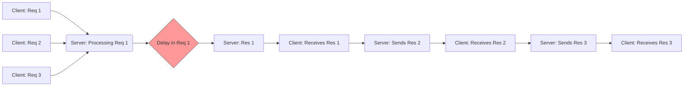
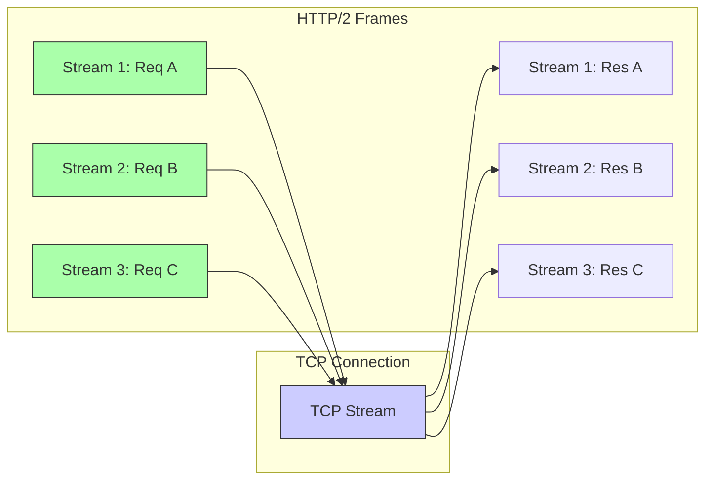

# 📚 Chapter 2: Application Protocols & Streaming

***

## Introduction: The Language of the Internet

In the grand architecture of distributed systems, the transport layer (TCP/IP, UDP) provides the reliable plumbing. However, the *application protocols* are the language—the grammar, syntax, and semantics—that allow disparate services to communicate meaningfully.

This chapter delves into the evolution of these application-layer protocols, examining how they have adapted to the demands of modern, high-throughput, low-latency systems, particularly those driven by AI and real-time data streams. We will move from the foundational request-response cycles of HTTP/1.1 to the multiplexed, stream-oriented paradigms of HTTP/3, while also exploring specialized protocols like JSON-RPC and the efficiency of Server-Sent Events (SSE).

***

## 2.1 The Evolution of HTTP: From Text to Streams

Hypertext Transfer Protocol (HTTP) is the foundational protocol of the World Wide Web. Its evolution reflects a continuous engineering effort to overcome the inherent limitations of its predecessors, primarily concerning concurrency and latency.

### 2.1.1 HTTP/1.1: The Foundational Model

HTTP/1.1 operates on a simple, sequential request-response model. A client sends a request, and the server sends a response.

#### Key Features and Limitations:

1.  **Request/Response Model:** Simple, synchronous interaction.
2.  **Keep-Alive Connections:** Allows multiple requests/responses to be sent over a single TCP connection, reducing the overhead of TCP handshakes.
3.  **Pipelining (The Flaw):** HTTP/1.1 introduced pipelining, allowing a client to send multiple requests before receiving the response for the first one. However, this feature was notoriously unreliable and often led to **Head-of-Line (HOL) Blocking**.

#### 🛑 Head-of-Line Blocking (HOL Blocking) in HTTP/1.1

If the first request in the pipeline encounters a delay (e.g., a slow database query), all subsequent requests, even if they are fast, must wait for the first response to be processed and transmitted. This serial dependency severely limits concurrency and throughput.

**ASCII Flow Diagram (HTTP/1.1 Pipelining Failure):**



### 2.1.2 HTTP/2: Multiplexing and Efficiency

HTTP/2 (defined in RFC 7540) fundamentally changed the protocol by introducing a **binary framing layer**. Instead of treating the entire request/response as a monolithic text block, HTTP/2 breaks everything down into smaller, standardized units called *frames*.

#### Core Innovations:

1.  **Binary Framing Layer:** This structured, binary format makes the protocol more efficient to parse and less prone to ambiguity than the text-based HTTP/1.1.
2.  **Stream Multiplexing:** This is the critical breakthrough. Multiple logical streams (requests/responses) can be interleaved and run concurrently over a *single* underlying TCP connection.
3.  **Elimination of HOL Blocking (at the application layer):** Because streams are independent, if one stream stalls, others can continue to transmit and receive data without waiting.
4.  **HPACK Header Compression:** HTTP headers can be verbose. HPACK uses a sophisticated indexing mechanism (based on static and dynamic tables) to compress redundant header information, significantly reducing overhead.
5.  **Server Push:** Allows the server to proactively send resources (e.g., CSS, images) to the client *before* the client explicitly requests them, optimizing page load times.

**ASCII Flow Diagram (HTTP/2 Multiplexing):**



### 2.1.3 HTTP/3: The UDP Revolution (QUIC)

While HTTP/2 solved application-layer HOL blocking, it still relied on TCP. TCP, by its nature, is a reliable, ordered, byte-stream protocol. This means that if a single packet is lost, TCP must halt the delivery of *all* subsequent packets until the lost packet is successfully retransmitted. This is **TCP Head-of-Line Blocking**.

HTTP/3 addresses this by replacing TCP with **QUIC** (Quick UDP Internet Connections), which runs over UDP.

#### QUIC's Advantages:

1.  **Elimination of TCP HOL Blocking:** QUIC implements stream-level reliability *on top of* UDP. If a packet belonging to Stream A is lost, only Stream A pauses for retransmission; Streams B and C continue uninterrupted.
2.  **Faster Connection Establishment (0-RTT):** QUIC integrates TLS 1.3 negotiation into the handshake, allowing for faster connection setup and, in some cases, zero-round-trip-time (0-RTT) resumption.
3.  **Connection Migration:** Because QUIC identifies connections using a unique ID rather than the source IP/port tuple (as TCP does), connections can survive changes in network topology (e.g., switching from Wi-Fi to cellular) without interruption.

**Summary Table: HTTP Protocol Comparison**

| Feature | HTTP/1.1 | HTTP/2 | HTTP/3 |
| :--- | :--- | :--- | :--- |
| **Transport Layer** | TCP | TCP | QUIC (over UDP) |
| **Concurrency** | Sequential (Pipelining) | Multiplexed (Streams) | Multiplexed (Streams) |
| **HOL Blocking** | Yes (Application Layer) | No (Application Layer) | No (Transport Layer) |
| **Header Compression** | None | HPACK | QPACK |
| **Connection Setup** | Slow (TCP + TLS Handshake) | Faster | Very Fast (0-RTT) |

***

## 2.2 RESTful Architecture & Resource Modeling

While HTTP is the transport, REST (Representational State Transfer) is an architectural style that dictates *how* resources should be modeled and accessed.

### 2.2.1 Principles of REST

A RESTful service treats data as **resources** (e.g., `/users/123`, `/products`). These resources are identified by URIs, and the client interacts with them by applying standard HTTP methods.

The core principles are:

1.  **Statelessness:** The server must not store any client context between requests. Every request from the client must contain all the information needed for the server to fulfill it. This massively improves scalability and resilience.
2.  **Client-Server Separation:** The client (frontend, mobile app) and the server (backend API) must evolve independently.
3.  **Uniform Interface:** The system must use a consistent, standardized interface (i.e., standard HTTP methods and resource modeling) to interact with all resources.
4.  **Idempotency:** A key property. An operation is idempotent if making the same request multiple times produces the same result as making it once.
    *   `GET` and `DELETE` are inherently idempotent.
    *   `PUT` is idempotent (replacing a resource multiple times yields the same state).
    *   `POST` is generally *not* idempotent (creating a resource multiple times usually results in multiple resources).

### 2.2.2 HTTP Methods and Status Code Semantics

The HTTP methods map directly to CRUD (Create, Read, Update, Delete) operations on a resource.

| Method | Purpose | Idempotent? | Semantics |
| :--- | :--- | :--- | :--- |
| **GET** | Retrieve a resource or collection. | Yes | Safe (no side effects). |
| **POST** | Submit data to create a new resource. | No | Used for non-idempotent actions (e.g., placing an order). |
| **PUT** | Replace an entire resource at a known URI. | Yes | Used for full updates. |
| **PATCH** | Apply partial modifications to a resource. | No (usually) | Used for granular updates. |
| **DELETE** | Remove a resource. | Yes | |

#### Standard HTTP Status Codes

Status codes are the server's way of communicating the outcome of the request.

| Code Range | Meaning | Common Examples | Description |
| :--- | :--- | :--- | :--- |
| **2xx** | **Success** | `200 OK`, `201 Created`, `204 No Content` | The request was successfully received, understood, and processed. |
| **3xx** | **Redirection** | `301 Moved Permanently`, `302 Found` | Further action is needed to complete the request. |
| **4xx** | **Client Error** | `400 Bad Request`, `401 Unauthorized`, `403 Forbidden`, `404 Not Found` | The client appears to have made an error. |
| **5xx** | **Server Error** | `500 Internal Server Error`, `503 Service Unavailable` | The server failed to fulfill a valid request. |

***

## 2.3 Specialized Protocols: RPC and Context Modeling

While REST is excellent for resource management, it can be cumbersome for complex, procedural tasks (e.g., "Run AI inference," "Process payment"). For these scenarios, Remote Procedure Call (RPC) patterns are often preferred.

### 2.3.1 JSON-RPC 2.0 Specification

JSON-RPC 2.0 is a lightweight, language-agnostic protocol that allows a client to invoke functions (procedures) on a remote server. It uses JSON objects for serialization.

#### Core Message Types:

1.  **Request:** The client asks the server to perform an action.
    ```json
    {
      "jsonrpc": "2.0",
      "method": "calculate_fibonacci",
      "params": [40],
      "id": 1
    }
    ```
2.  **Response:** The server returns the result of the request.
    ```json
    {
      "jsonrpc": "2.0",
      "result": 102334155,
      "id": 1
    }
    ```
3.  **Notification:** A message sent by the client that the server must process but does not require a response (e.g., an event trigger).
    ```json
    {
      "jsonrpc": "2.0",
      "method": "log_event",
      "params": ["user_login"]
    }
    ```
4.  **Error Object:** Used when the server fails to execute the procedure.
    ```json
    {
      "jsonrpc": "2.0",
      "error": {
        "code": -32601,
        "message": "Method not found"
      },
      "id": 1
    }
    ```
5.  **Batching:** Allows a client to send multiple requests in a single HTTP payload, improving network efficiency.

### 2.3.2 Model Context Protocol (MCP): The Universal Agent Substrate

The **Model Context Protocol (MCP)**, originally open-sourced by Anthropic and rapidly adopted by leading developer tools (Antigravity, Cursor, Claude Desktop, Windsurf), standardizes how AI applications connect to external tools, context sources, and backend services.

Before MCP, every developer tool invented its own proprietary plugin API or tool-calling schema. An agent framework written for LangChain could not easily expose tools to Cursor, and an IDE extension could not natively inspect another agent's telemetry. MCP solves this fragmentation by establishing an open, JSON-RPC 2.0-based protocol for bi-directional context exchange.

#### Architectural Roles in MCP

1. **Host (Client/IDE):** The conversational interface or reasoning orchestrator (e.g., Antigravity, Claude Desktop, Cursor). It spawns or connects to MCP servers, discovers available tools and prompts, and coordinates tool execution based on LLM intent.
2. **MCP Server (Substrate / Tool Provider):** A lightweight process exposing tools, resources, and prompt templates. In AgentTrace, this is implemented as a standalone, zero-dependency native Rust binary (`agent_trace_mcp.exe`).
3. **Daemon / Target Backend:** The persistent service executing heavy workloads, maintaining state, and guarding resources. `agent_trace_mcp.exe` acts as an ergonomic, stdio-to-HTTP gateway translating IDE requests into authenticated calls against `http://localhost:8080`.

#### The Transport Layer: Stdio vs. HTTP+SSE

MCP defines two primary transport mechanisms:
* **Standard I/O (`stdio`):** The Host spawns the MCP server executable as a child process and communicates via newline-delimited JSON-RPC 2.0 messages over standard input (`stdin`) and standard output (`stdout`). Standard error (`stderr`) is reserved for out-of-band human-readable diagnostics and debugging. This mode requires zero network port allocation, works seamlessly behind firewalls, and enforces process-level lifecycle coupling.
* **Server-Sent Events over HTTP (`sse`):** Used when the server runs on a remote machine. The client initiates an HTTP GET request to receive continuous SSE event streams and POSTs JSON-RPC requests to a separate command endpoint.

```mermaid
graph TD
    subgraph AI IDE / Host (Antigravity, Cursor, Claude Desktop)
        A[LLM Reasoning Engine] --> B[MCP Client Controller]
    end

    subgraph Native MCP Process (agent_trace_mcp.exe)
        C[stdio Line Reader] --> D[JSON-RPC 2.0 Dispatcher]
        D --> E[HTTP Reqwest Client]
    end

    subgraph Background Daemon (agent_trace_gw.exe)
        F[Axum API Server :8080] --> G[Cryptographic Ledger]
        F --> H[CAS Pre-Image Guard]
        F --> I[Prompt Hub & Mesh Router]
    end

    B <-->|stdin / stdout (JSON-RPC 2.0)| C
    E <-->|Local HTTP REST /api/v1/...| F
```

#### MCP Lifecycle & Handshake Flow

An MCP session proceeds through four deterministic stages:

1. **Initialization (`initialize`):**
   The host transmits its client metadata, protocol version (`2024-11-05`), and declared capabilities. The server replies with its server information and supported capability blocks (`tools`, `resources`, `prompts`).
   ```json
   // Request (Host -> Server)
   {
     "jsonrpc": "2.0",
     "id": 1,
     "method": "initialize",
     "params": {
       "protocolVersion": "2024-11-05",
       "capabilities": {},
       "clientInfo": { "name": "antigravity", "version": "1.0.0" }
     }
   }

   // Response (Server -> Host)
   {
     "jsonrpc": "2.0",
     "id": 1,
     "result": {
       "protocolVersion": "2024-11-05",
       "capabilities": {
         "tools": { "listChanged": false }
       },
       "serverInfo": {
         "name": "agent-trace-mcp",
         "version": "0.1.0"
       }
     }
   }
   ```

2. **Initialized Notification (`notifications/initialized`):**
   The host sends a one-way notification acknowledging readiness.

3. **Tool Discovery (`tools/list`):**
   The host requests all registered tools. The server responds with an array of tool objects, each containing a name, description, and JSON Schema `inputSchema`.
   ```json
   {
     "jsonrpc": "2.0",
     "id": 2,
     "method": "tools/list",
     "params": {}
   }
   ```

4. **Tool Execution (`tools/call`):**
   When the model decides to invoke a tool, the host sends `tools/call` with parameters conforming to the advertised schema:
   ```json
   {
     "jsonrpc": "2.0",
     "id": 3,
     "method": "tools/call",
     "params": {
       "name": "log_event",
       "arguments": {
         "source": "antigravity-lead",
         "event_type": "file_write",
         "target": "C:/cada/projects/Strux/src/cad/extrude.rs",
         "details": "Refactored extrude modifier into SRP module"
       }
     }
   }
   ```

#### The AgentTrace Native Tool Catalog

The `agent_trace_mcp` executable exposes 8 high-level governance and orchestration tools directly to the IDE:

| Tool Name | Parameters | Description |
| :--- | :--- | :--- |
| `log_event` | `source`, `event_type`, `target`, `details` | Commits an event to the actor-based SHA-256 cryptographic ledger. |
| `verify_ledger` | *(none)* | Audits the entire blockchain-style ledger on disk, verifying hashes and signatures. |
| `get_threat_summary` | *(none)* | Queries the real-time behavioral analytics engine for Blast Radius Scores and BPI violations. |
| `get_active_nodes` | *(none)* | Returns cluster nodes discovered over UDP `:8089` and their live model capabilities. |
| `proxy_chat_completion` | `model`, `prompt`, `temperature` | Routes prompts through the Zero-Token Hub to local/cluster models (`qwen3.8:27b`, `deepseek-r1:1.5b`). |
| `upsert_workgroup` | `id`, `name`, `description`, `lead_node_id`, `worker_node_ids` | Declares or reconfigures an agent problem workgroup. |
| `attach_workgroup_rule`| `workgroup_id`, `rule_path`, `content` | Dynamically attaches a markdown rule mesh (e.g. Work-First UI or Anti-Monolith invariants). |
| `deploy_cluster_worker` | `target_host`, `method`, `user`, `target_dir` | Executes Zero-Walk OTA distribution to provision a worker node over the network. |

***

## 2.4 Real-Time Streaming for AI Generation

Modern AI systems, particularly Large Language Models (LLMs), generate output token-by-token. Waiting for the entire response to be generated before displaying the first token is a poor user experience. Streaming is the solution.

### 2.4.1 Server-Sent Events (SSE)

SSE is a standard web technology that allows a server to push data updates to a client over a single, long-lived HTTP connection. It is fundamentally **unidirectional** (Server $\rightarrow$ Client).

#### Technical Details:

*   **MIME Type:** The connection must be opened with the `Content-Type: text/event-stream` header.
*   **Event Formatting:** Data is sent in a specific, structured format:
    ```
    data: This is the first token.
    data: This is the second token.

    event: error
    data: Generation failed.
    ```
*   **Connection Keep-Alives:** SSE connections are designed to remain open indefinitely, allowing the server to push data whenever it becomes available. The browser handles automatic reconnection if the connection drops.

#### 💡 Why SSE is Optimal for Token Streaming

For AI generation, the client only needs to *receive* the tokens. It does not need to send complex, continuous control signals back to the server while the generation is running. SSE provides a simple, low-overhead, and natively supported mechanism for this unidirectional flow, making it superior to the complexity of WebSockets for this specific use case.

### 2.4.2 WebSockets vs. SSE: A Comparative Analysis

| Feature | Server-Sent Events (SSE) | WebSockets |
| :--- | :--- | :--- |
| **Directionality** | Unidirectional (Server $\rightarrow$ Client) | Full Duplex (Bi-directional) |
| **Protocol** | HTTP (Long Polling/Streaming) | WS (Dedicated TCP Handshake) |
| **Overhead** | Low (Built on HTTP) | Low (After handshake) |
| **Use Case** | Token streaming, live notifications, stock tickers. | Interactive gaming, chat applications, real-time collaborative editing. |
| **Complexity** | Simple to implement and manage. | Requires managing two separate communication channels. |

**Conclusion:** If the primary goal is to stream generated tokens to a user interface, SSE is the most elegant and efficient choice. If the application requires the client to send continuous, low-latency control commands (e.g., "stop generation," "change temperature") while the server is running, WebSockets are necessary.

### 2.4.3 Practical Implementation: SSE in Rust (Tokio & Axum)

To demonstrate the practical application of SSE, we will outline a pattern using the Rust ecosystem, leveraging `tokio` for asynchronous runtime and `axum` for the web server framework.

The key is to return a stream of data that the HTTP server knows how to serialize as `text/event-stream`.

```rust
// main.rs (Conceptual Axum/Tokio implementation)

use axum::{
    extract::State,
    http::StatusCode,