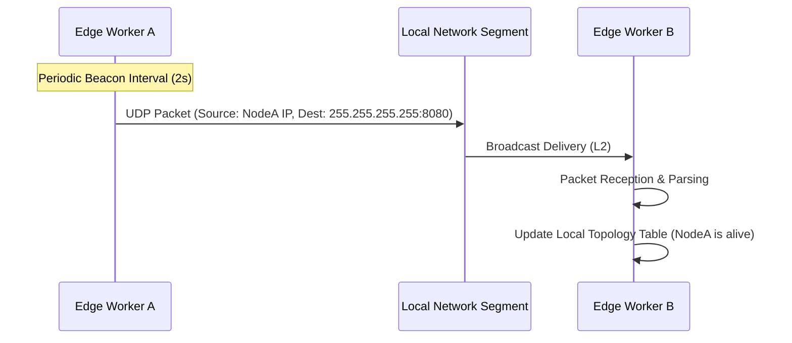
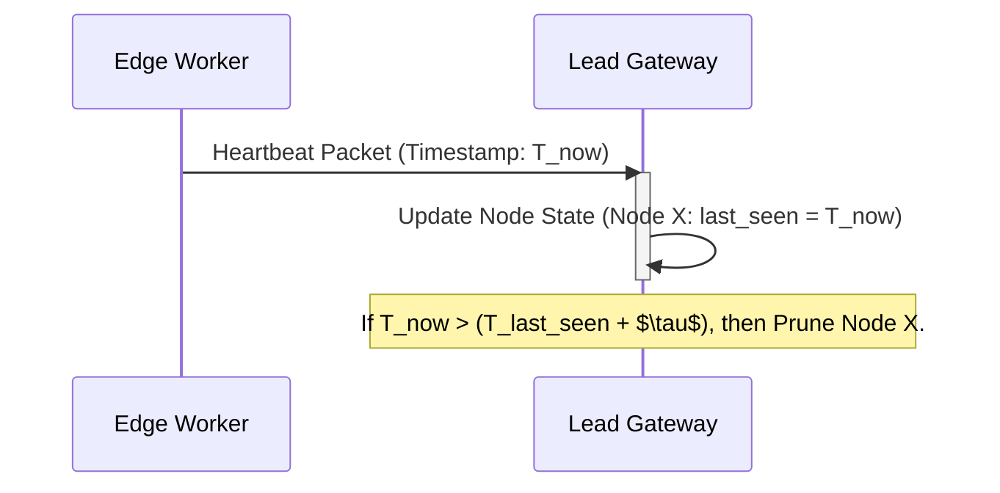
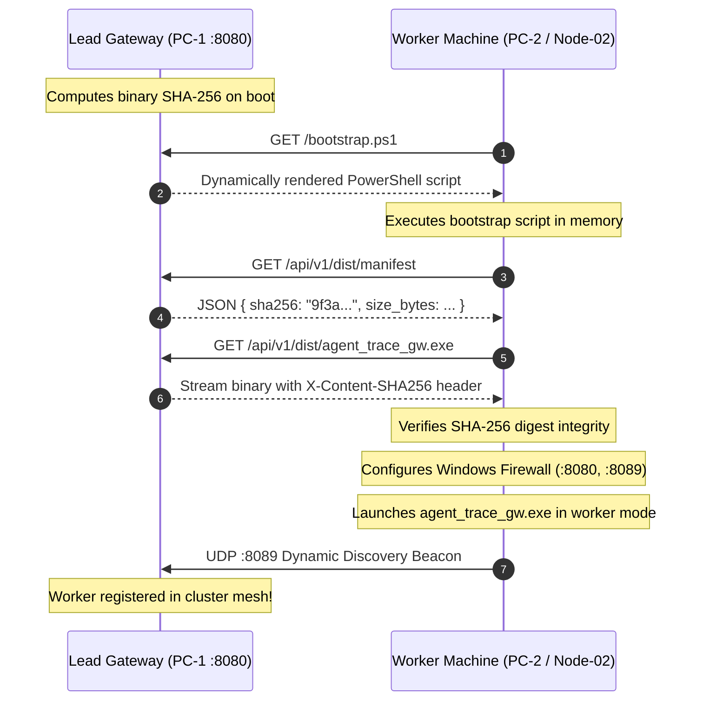

# 📚 Chapter 4: Local Mesh Discovery & Zero-Conf Clustering

***

## 4.1 Introduction: The Necessity of Self-Organization

In modern distributed systems, particularly those deployed at the network edge, the traditional centralized control plane (e.g., a monolithic configuration server or a global DNS registry) introduces unacceptable latency, single points of failure, and excessive bandwidth overhead. Edge clusters—characterized by resource constraints, intermittent connectivity, and high operational autonomy—demand a fundamentally different approach to service discovery and cluster management.

This chapter details the architectural patterns required to achieve **Zero-Configuration Networking (Zero-Conf)** and robust, self-healing clustering. We move beyond static IP assignments and centralized registry lookups, implementing peer-to-peer discovery mechanisms that allow nodes to autonomously locate, register, and communicate with their neighbors within a local mesh.

The core philosophy is simple: *The network must be able to discover itself.*

***

## 4.2 Zero-Configuration Networking (Zero-Conf)

Zero-Conf networking is the practice of enabling devices to discover and communicate with each other without requiring manual configuration, DHCP servers, or a centralized naming service. This is critical for ephemeral edge deployments where nodes may be spun up and torn down rapidly.

### 4.2.1 Discovery Mechanisms: Broadcast vs. Multicast

The primary challenge in Zero-Conf is how a node announces its presence and how other nodes listen for that announcement. Two primary mechanisms exist:

#### A. UDP Broadcast (`255.255.255.255`)
UDP Broadcast sends a packet to every host on the local subnet.

*   **Pros:** Simple to implement; guaranteed delivery to all local listeners.
*   **Cons:** Highly inefficient. It floods the entire local network segment, consuming unnecessary CPU cycles and network bandwidth. It is strictly limited to the Layer 2 (L2) broadcast domain (i.e., the local subnet).
*   **Use Case:** Initial, low-frequency discovery beacons.

#### B. UDP Multicast (e.g., mDNS, SSDP)
Multicast sends a packet to a specific group address (e.g., `224.0.0.251`). Routers can be configured to forward these packets only to interested subnets, or the local network stack handles the group membership.

*   **Pros:** Highly efficient. Only nodes actively listening to the multicast group receive the packet. It scales better than broadcast.
*   **Cons:** Requires proper network configuration (IGMP snooping) to function optimally.
*   **Use Case:** Continuous, low-latency service announcements (e.g., DNS resolution via mDNS).

**Architectural Choice:** For robust cluster discovery, we employ a hybrid approach. We use a low-frequency **UDP Broadcast Beacon** for initial discovery (ensuring reachability even if multicast routing is misconfigured) and then transition to **Multicast** for continuous, efficient heartbeats and service registration.

### 4.2.2 Designing the UDP Discovery Beacon in Rust

The beacon is a lightweight, periodic packet containing essential node metadata (Node ID, Cluster ID, Service Ports). Implementing this requires careful manipulation of the socket options to enable broadcast functionality.

The following Rust example demonstrates the core logic for binding a socket and emitting a periodic broadcast packet.

```rust
use std::net::{UdpSocket, SocketAddr};
use std::time::Duration;
use std::thread;

const BROADCAST_ADDR: &str = "255.255.255.255:8080";
const BEACON_INTERVAL_MS: u64 = 2000;

#[derive(Debug)]
struct NodeMetadata {
    node_id: u64,
    cluster_id: u32,
    service_port: u16,
}

fn main() -> Result<(), Box<dyn std::error::Error>> {
    // 1. Socket Binding: Bind to 0.0.0.0:0 to let the OS choose a free ephemeral port.
    let socket = UdpSocket::bind("0.0.0.0:0")?;

    // 2. Enabling Broadcast Flag: Crucial step for sending to 255.255.255.255.
    // This requires platform-specific socket options.
    socket.set_broadcast(true)?;
    println!("Socket bound and broadcast enabled.");

    let metadata = NodeMetadata {
        node_id: 42,
        cluster_id: 101,
        service_port: 8080,
    };

    // Serialize metadata into a simple byte payload (e.g., using bincode or JSON)
    let payload = format!("NODE_BEACON:ID={}:CLUSTER={}:PORT={}", 
                           metadata.node_id, metadata.cluster_id, metadata.service_port);
    let payload_bytes = payload.as_bytes();

    // 3. Cyclic Packet Emission
    loop {
        match socket.send_to(payload_bytes, BROADCAST_ADDR) {
            Ok(_) => println!("-> Beacon sent successfully to {}", BROADCAST_ADDR),
            Err(e) => eprintln!("Error sending beacon: {}", e),
        }
        thread::sleep(Duration::from_millis(BEACON_INTERVAL_MS));
    }
}
```

**Conceptual Packet Diagram: Discovery Beacon**



***

## 4.3 Node Lifecycle and Cluster Topology Management

Once nodes can discover each other, they must maintain a coherent view of the cluster state. This requires a robust mechanism for registration, state tracking, and failure detection.

### 4.3.1 Edge Worker Registration and Metadata Ingestion

When an Edge Worker initializes, it must register its capabilities with the cluster's designated **Lead Gateway** (the primary coordination node). This registration is not merely an IP address; it is a rich metadata exchange.

**Required Metadata Payload:**

1.  **Hardware Fingerprint:** CPU model, RAM size, GPU presence (e.g., NVIDIA CUDA version, memory capacity).
2.  **Local Weights:** A manifest listing the specific ML models or weights the worker possesses (e.g., `model_v3.bin`, `weights_local_A`).
3.  **Service Endpoints:** The specific ports and protocols the worker exposes (e.g., `HTTP/8080`, `gRPC/8642`).
4.  **Cluster ID:** The unique identifier of the mesh it belongs to.

The Lead Gateway maintains a dynamic **Topology Graph**, where nodes are vertices and communication links are edges.

### 4.3.2 Heartbeat Protocols and Autonomous Pruning

The most critical aspect of cluster management is failure detection. Relying solely on connection attempts is insufficient, as transient network congestion can mimic a node failure. We implement a **TTL-based Heartbeat Protocol**.

Each node periodically sends a lightweight heartbeat packet (e.g., every 5 seconds) to the Lead Gateway, confirming its operational status.

**Mechanism:**

1.  **Timestamping:** The Lead Gateway records the `last_seen` timestamp for every registered node.
2.  **Time-to-Live (TTL) Threshold:** A predefined threshold ($\tau$) is set (e.g., 15 seconds).
3.  **Pruning:** If a node's `last_seen` timestamp exceeds $\tau$, the Lead Gateway autonomously marks the node as **STALE** and removes it from the active Topology Graph.

This mechanism is autonomous and requires no external monitoring service, fulfilling the Zero-Conf mandate.

**Conceptual Heartbeat Flow:**



***

## 4.4 LAN Security and Network Traversal

While Zero-Conf simplifies discovery, it inherently increases the attack surface. Security must be layered, addressing both network boundaries and application-level trust.

### 4.4.1 Subnet Boundary Constraints: L2 vs. L3

It is vital to understand the difference between Layer 2 (L2) and Layer 3 (L3) broadcast domains:

*   **L2 Broadcast Domain (The LAN):** All devices within the same subnet (e.g., `192.168.1.0/24`) can receive L2 broadcasts (like `255.255.255.255`). This is where our discovery beacons operate.
*   **L3 Broadcast Domain (The Internet/WAN):** Routers segment the network based on IP addresses. L2 broadcasts *do not* cross L3 boundaries.

**Implication:** Our Zero-Conf discovery is strictly limited to the local LAN. If a node needs to find a service outside the local subnet, it must use a centralized, external DNS or service registry.

### 4.4.2 Firewall Considerations and Port Exposure

For the cluster to function, specific ports must be open on the local firewall of each Edge Worker and the Lead Gateway. These ports are not arbitrary; they correspond to the services defined in the node's metadata.

| Port | Protocol | Service Function | Description |
| :--- | :--- | :--- | :--- |
| **8080** | UDP/TCP | Discovery Beacon | Used for initial Zero-Conf discovery and health checks. |
| **8642** | TCP/gRPC | Service Endpoint | Primary high-throughput inference endpoint for ML models. |
| **8089** | TCP/HTTP | Agent Control Plane | Used for administrative commands, configuration updates, and token exchange. |

**Security Mandate:** All these ports must be configured to only accept connections originating from known, trusted IP ranges within the cluster subnet.

### 4.4.3 Token-Based Mutual Authentication

Relying solely on network location (IP address) is insufficient for security. We implement **Mutual Authentication** using short-lived, cryptographically signed tokens.

When an Edge Worker attempts to communicate with the Lead Gateway (or another peer), it must present a token in the request header.

**Token Flow (`x-agenttrace-token`):**

1.  **Initial Handshake:** The Edge Worker connects to the Lead Gateway's control plane (`:8089`).
2.  **Authentication Request:** The worker sends its Node ID and a nonce.
3.  **Token Issuance:** The Lead Gateway verifies the worker's identity (via pre-shared keys or certificate pinning) and issues a signed JWT (JSON Web Token) containing the worker's identity and an expiration time.
4.  **Subsequent Requests:** The worker includes this token in the header of all subsequent requests (e.g., `Authorization: Bearer <token>`).
5.  **Verification:** The Lead Gateway validates the token's signature, expiration, and claims before processing the request.

This token-based approach ensures that even if an attacker gains access to the local network, they cannot impersonate a legitimate node without possessing the private signing key used by the Lead Gateway.

**Example HTTP Request Header:**

```http
POST /api/v1/inference
Host: edge-worker-42.local
Content-Type: application/json
X-AgentTrace-Token: eyJhbGciOiJSUzI1NiIsInR5cCI6IkpXVCJ9.eyJpZCI6NDIiLCJpYXQiOjE2NzgwMDQwMDAsImV4cCI6MTY3ODAwNDQwMH0.Sg...
```

***

***

## 4.5 Zero-Walk Over-the-Air (OTA) Binary Distribution & Bootstrap Architecture

In real-world multi-machine topologies (such as developer workstations, lab nodes, and GPU servers), the biggest barrier to deploying a distributed agent cluster is operational friction: **the "sneaker-net" paradox**. Manually walking over to physical machines, configuring dependencies, copying binaries via USB, and fighting firewall dialogs defeats the very premise of autonomous computing.

AgentTrace solves this with a **Zero-Walk Over-the-Air (OTA) Distribution Substrate** embedded directly within the Rust gateway binary.



### 4.5.1 Self-Inspecting Binary Distribution (`src/ota_dist.rs`)

The gateway binary acts as its own package repository. Using `std::env::current_exe()`, the running executable locates its own binary on disk and computes a cryptographic SHA-256 digest at startup. It then serves these endpoints:

1. **`GET /api/v1/dist/manifest`**:
   Returns the authoritative distribution manifest containing the binary name, size in bytes, and the Ring-computed SHA-256 hash.
   ```json
   {
     "binary_name": "agent_trace_gw.exe",
     "sha256": "3a7bd28e4695c0245a165be87034c56e3557e4b97a06f4777c229cfb234bb485",
     "size_bytes": 18274304,
     "server_time_utc": "2026-10-17T19:26:31Z"
   }
   ```

2. **`GET /api/v1/dist/agent_trace_gw.exe`**:
   Streams the raw binary executable over HTTP with custom cryptographic headers:
   ```http
   HTTP/1.1 200 OK
   Content-Type: application/octet-stream
   Content-Disposition: attachment; filename="agent_trace_gw.exe"
   X-Content-SHA256: 3a7bd28e4695c0245a165be87034c56e3557e4b97a06f4777c229cfb234bb485
   ```

### 4.5.2 Dynamic Bootstrap Templating (`/bootstrap.ps1`, `/join.cmd`, `/worker.cmd`, `/winrm.cmd`)

When a new worker machine boots, the operator (or an orchestration script) can use any of several dynamically generated, zero-dependency entry points:

1. **Interactive Web Join Portal (`GET /join`)**:
   Visiting `http://<lead-ip>:8080/join` from any browser on the LAN renders a high-density operator card displaying the detected IP, 1-click copy buttons, and diagnostic checks.

2. **Windows PowerShell Bootstrap (`/bootstrap.ps1` & `/join.cmd`)**:
   ```powershell
   irm http://192.168.1.101:8080/join.cmd | iex
   ```
   *Downloads the manifest, asserts SHA-256 integrity, provisions Windows Defender firewall rules, and starts the worker daemon.*

3. **Standalone Worker Launcher (`/worker.cmd`)**:
   ```cmd
   curl -s http://192.168.1.101:8080/worker.cmd -o worker.cmd && worker.cmd
   ```
   *Runs `agent_trace_gw.exe --worker --lead http://<lead-ip>:8080` directly.*

4. **1-Click WinRM Enablement Script (`/winrm.cmd` & `/winrm.ps1`)**:
   ```powershell
   irm http://192.168.1.101:8080/winrm.cmd | iex
   ```
   *Configures `LocalAccountTokenFilterPolicy`, enables PSRemoting, and sets `TrustedHosts` across the local subnet, enabling safe remote command push from the Lead Node.*

### 4.5.3 Remote Worker Push Deployment (`POST /api/v1/cluster/deploy-worker`)

To eliminate physical interaction entirely, the Lead Gateway provides a remote deployment API (`deploy-worker`) and a corresponding MCP tool (`deploy_cluster_worker`).

When invoked with `target_host`, `user`, and `method` (`ssh` or `winrm`), the Lead connects over the network, pushes the bootstrap command, and verifies that the new node begins broadcasting heartbeats on UDP `:8089` within a 15-second window.

### 4.5.4 Dynamic Inference Model Inspection

Worker nodes automatically discover and introspect their local AI engines upon startup:
* **Ollama Engine (`http://127.0.0.1:11434/api/tags`)**: Discovers locally installed models (e.g., `qwen3.8:27b`, `qwen3:14b`).
* **Hermes Agent Engine (`http://127.0.0.1:8642/v1/models`)**: Discovers CUDA-accelerated models (e.g., `deepseek-r1:1.5b`).

These discovered models are packed into the UDP `:8089` discovery beacon. The Lead Gateway dynamically registers each worker's models in its Prompt Hub routing table without requiring static configuration files.

***

## 4.6 Summary and Key Takeaways

Chapter 4 has established the architectural patterns for autonomous, self-organizing edge clusters:

* **Zero-Conf Mesh Discovery**: Realized via periodic UDP Broadcast beacons on port `8089`.
* **Zero-Walk OTA Distribution**: Self-serving binary distribution and dynamic bootstrap scripts eliminate manual per-machine setup.
* **Remote Deployment Push**: Orchestrators provision remote cluster workers programmatically via SSH/WinRM.
* **Dynamic Capability Mapping**: Autonomous node-level inspection of Ollama and Hermes engines automatically populates the cluster routing fabric.
* **Cryptographic Resilience**: Enforced via SHA-256 pre-execution binary verification and Ed25519 node identity signatures.