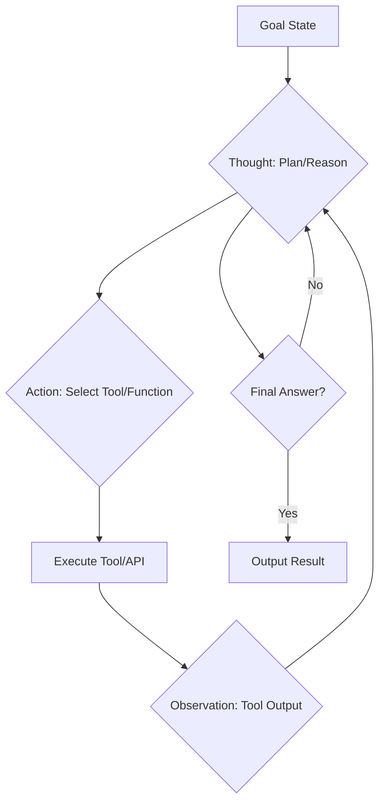
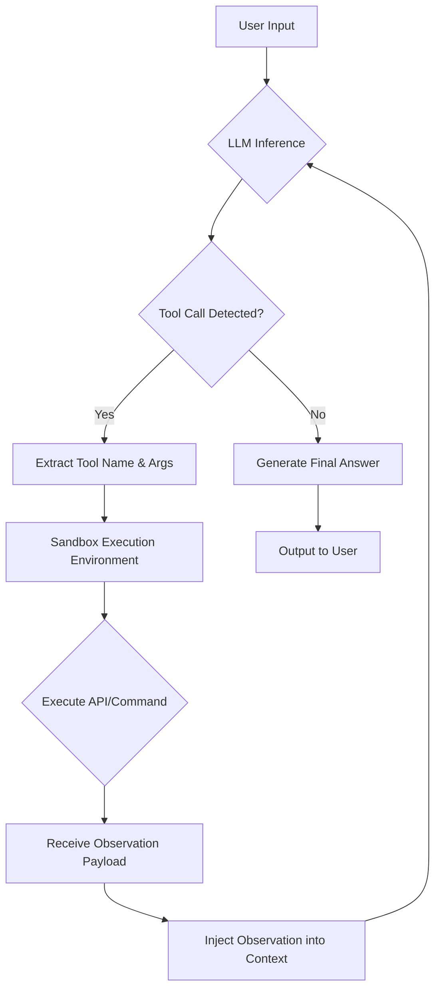
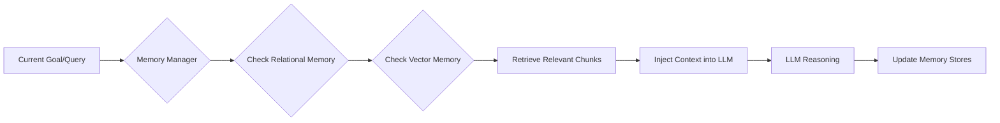

# 📚 Chapter 5: Anatomy of Autonomous AI Agents

***

## Introduction: From Predictor to Agent

The initial wave of Large Language Models (LLMs) demonstrated remarkable proficiency in statistical pattern matching, effectively mastering the task of **next-token prediction**. While this capability is foundational, it represents a passive, reactive form of intelligence. An LLM, in its pure form, is a sophisticated autocomplete engine.

The transition from a passive text generator to an **Autonomous AI Agent** marks a paradigm shift in AI engineering. An agent is not merely a predictor; it is a system capable of perceiving its environment, reasoning about its goals, selecting appropriate actions, executing those actions, and learning from the outcomes—a closed-loop system of continuous self-improvement and goal pursuit.

This chapter dissects the architectural components necessary to build robust, reliable, and truly autonomous agents, focusing on the cognitive loops, external grounding mechanisms, standardized communication protocols, and memory management systems that define modern agentic architectures.

***

## 5.1 The Evolution of Machine Agency

The development of agency has been driven by the need to imbue LLMs with structured reasoning capabilities that transcend simple linguistic fluency.

### 5.1.1 Beyond Next-Token Prediction

The core challenge is bridging the gap between *linguistic understanding* (what the model knows) and *operational capability* (what the model can do). Early models struggled with multi-step tasks, often failing due to a lack of internal planning or the inability to verify intermediate steps.

The evolution of cognitive architectures addresses this by forcing the model to externalize its thought process, turning the black-box prediction into a verifiable, structured sequence of operations.

### 5.1.2 Key Agent Cognitive Architectures

#### A. Chain-of-Thought (CoT)
CoT is the foundational technique. By prompting the model to "think step-by-step," we leverage the LLM's inherent ability to decompose complex problems. This transforms a single, high-variance prediction into a sequence of lower-variance, verifiable sub-problems.

$$
\text{Input} \xrightarrow{\text{Prompting}} \text{Thought}_1 \rightarrow \text{Thought}_2 \rightarrow \dots \rightarrow \text{Final Answer}
$$

#### B. ReAct (Reason + Act)
ReAct elevates CoT by introducing an explicit action-observation loop. It mandates that the model alternates between generating a **Thought** (internal reasoning), selecting an **Action** (calling an external tool), and processing the resulting **Observation** (the tool's output).

**ReAct Flow Diagram:**



#### C. Reflexion
Reflexion is a meta-cognitive layer built upon ReAct. It introduces self-correction and reflective learning. When an agent fails a task or receives a negative observation, Reflexion prompts the agent to analyze *why* the previous plan failed, update its internal strategy, and attempt the task again with improved reasoning.

**Reflexion Mechanism:**
1. **Execution:** Agent attempts Task $T$.
2. **Failure:** Task $T$ fails or yields suboptimal results.
3. **Reflection:** Agent is prompted with the failure state and the original goal.
4. **Update:** Agent generates a refined internal policy or plan ($\text{Policy}'$).
5. **Re-Execution:** Agent attempts Task $T$ using $\text{Policy}'$.

#### D. Plan-and-Solve Loops
For extremely complex, long-horizon tasks (e.g., "Build a website and deploy it"), the agent must transition from reactive execution to proactive planning. This involves:
1. **Planning Phase:** Decomposing the high-level goal into a hierarchical sequence of sub-goals (e.g., *Design $\rightarrow$ Code $\rightarrow$ Test $\rightarrow$ Deploy*).
2. **Execution Phase:** Iteratively executing the smallest, current sub-goal using the ReAct loop.
3. **Monitoring/Refinement:** Continuously checking the state against the plan and dynamically re-planning if an external event invalidates the current path.

***

## 5.2 Tool Calling & External World Grounding

The most critical component of agency is the ability to interact with the world outside the LLM's token space. This is achieved through **Tool Calling** (or Function Calling).

### 5.2.1 The OpenAI Tool/Function Calling Specification

Modern LLM APIs provide a standardized mechanism for the model to declare its intent to use an external function. This process relies heavily on structured data definition, typically using **JSON Schema**.

**Mechanism:**
1. **Definition:** The developer provides the LLM with a schema describing available tools (functions), including their name, description, and required parameters.
2. **Inference:** When the user prompt requires external data (e.g., "What is the weather in London?"), the LLM does not generate the answer; instead, it generates a structured JSON object specifying the function name and the arguments (parameters) it believes are necessary.
3. **Validation:** The API and the execution environment validate this JSON against the provided schema, ensuring type safety and parameter correctness.

**Example (Conceptual JSON Schema):**
```json
{
  "type": "function",
  "function": {
    "name": "get_current_weather",
    "description": "Fetches the current weather conditions for a given location.",
    "parameters": {
      "type": "object",
      "properties": {
        "location": {
          "type": "string",
          "description": "The city and state, e.g., San Francisco, CA."
        },
        "unit": {
          "type": "string",
          "enum": ["celsius", "fahrenheit"],
          "description": "The temperature unit to use."
        }
      },
      "required": ["location"]
    }
  }
}
```

### 5.2.2 The Execution Loop: Grounding the Agent

The agent's execution loop is a tightly controlled state machine that mediates between the LLM's abstract reasoning and the deterministic reality of the external environment.

**Execution Flowchart:**



#### Sandboxing and Safety
Crucially, the execution environment (Step F) must be **sandboxed**. If the agent is allowed to execute arbitrary system commands (e.g., `rm -rf /`), a malicious or erroneous LLM could compromise the host system. Sandboxing isolates the execution, limiting the scope of possible actions (e.g., read-only access to specific APIs, restricted network calls).

***

## 5.3 The Model Context Protocol (MCP) Standard

As agents grow in complexity, the internal architecture becomes a tangled mess of proprietary API calls, database drivers, and custom prompt templates. This lack of standardization severely limits interoperability.

The **Model Context Protocol (MCP)** is a proposed standard designed to decouple the LLM's reasoning frontend from the heterogeneous backend services (databases, APIs, knowledge graphs, etc.).

### 5.3.1 Universal Interoperability and Decoupling

MCP defines a universal contract for how an agent interacts with its environment, regardless of whether the environment is a PostgreSQL database, a proprietary CRM API, or a simple file system.

**Goal:** To allow a single LLM frontend (e.g., GPT-4, Claude 3) to interact seamlessly with a diverse suite of backends without requiring custom adapter code for every single LLM/Backend pairing.

### 5.3.2 MCP Server Lifecycle and API Endpoints

The MCP defines a set of standardized RESTful or gRPC endpoints that the agent's backend must implement.

| Endpoint | HTTP Method | Purpose | Description |
| :--- | :--- | :--- | :--- |
| `/initialize` | `POST` | **Setup** | Initializes the agent session, setting context and initial constraints. |
| `/tools/list` | `GET` | **Discovery** | Returns a standardized list of all available tools/functions and their MCP-compliant JSON Schemas. |
| `/tools/call` | `POST` | **Execution** | Accepts a structured call request (Tool Name, Parameters) and executes the corresponding backend function. |
| `/resources/list` | `GET` | **State Query** | Allows the agent to query the current state of persistent resources (e.g., "List all open tickets"). |
| `/prompts/list` | `GET` | **Template Access** | Provides access to pre-defined, optimized prompt templates for specific tasks (e.g., `summarization_v2`). |

**MCP Data Flow:**
1. **Agent asks:** "What tools do you have?" $\rightarrow$ `GET /tools/list`
2. **Backend responds:** JSON list of available functions and schemas.
3. **Agent decides:** "I need to run `get_weather`." $\rightarrow$ `POST /tools/call` with parameters.
4. **Backend executes:** Calls the actual weather API.
5. **Backend returns:** Observation payload $\rightarrow$ Injected back into the LLM context.

***

## 5.4 Agent Context & Memory Systems

The LLM's context window is its immediate, short-term working memory. However, real-world agency requires persistence, recall, and the ability to learn from past experiences.

### 5.4.1 Context Window Constraints and Quadratic Attention

The context window ($\text{C}$) is the finite sequence of tokens the LLM can process in a single inference call. This constraint is fundamental.

The computational complexity of the Transformer architecture is $O(N^2)$, where $N$ is the sequence length (context window size). This quadratic complexity means that doubling the context window quadruples the computational cost. This inherent limitation dictates that agents cannot simply feed the entire history of their existence into every prompt.

### 5.4.2 Memory Hierarchy

To overcome the context window limitation, agents must employ a sophisticated memory hierarchy:

#### A. Ephemeral Working Memory (Short-Term)
This is the active context window itself. It holds the immediate conversation history, the current plan, the last few tool observations, and the current thought chain. It is volatile and is discarded after the turn ends, unless explicitly summarized and passed forward.

#### B. Persistent Vector Memory (Long-Term Knowledge)
This memory stores unstructured, high-dimensional representations of past experiences, documents, and knowledge.
*   **Mechanism:** Information is chunked, embedded (converted into dense vectors using an embedding model), and stored in a Vector Database (e.g., Pinecone, Chroma).
*   **Retrieval:** When the agent needs relevant past knowledge, it generates a query embedding, performs a similarity search (e.g., cosine similarity) against the vector store, and retrieves the most semantically relevant chunks. These chunks are then injected into the ephemeral context window.
*   **Use Case:** Answering questions based on a vast corpus of proprietary documents.

#### C. Relational/Structured Memory (Long-Term State)
This memory stores discrete, structured facts, state changes, and key-value pairs.
*   **Mechanism:** Typically implemented using a traditional database (SQL, NoSQL).
*   **Use Case:** Tracking the state of a long-running task (e.g., "Ticket #123 is currently in the 'Review' phase," or "The user's preferred unit is 'Celsius'"). This is crucial for maintaining continuity across sessions.

**Memory Integration Flow:**



***

## Conclusion

The autonomous AI agent is not a single model; it is a complex, multi-layered system. Its anatomy comprises a sophisticated cognitive loop (ReAct, Reflexion) that drives reasoning, a robust grounding mechanism (Tool Calling) that connects it to the real world, a standardized communication layer (MCP) that ensures interoperability, and a hierarchical memory system that provides persistence and recall.

Mastering these components is the current frontier of systems architecture, moving AI from a powerful predictive tool to a truly proactive and capable digital collaborator.