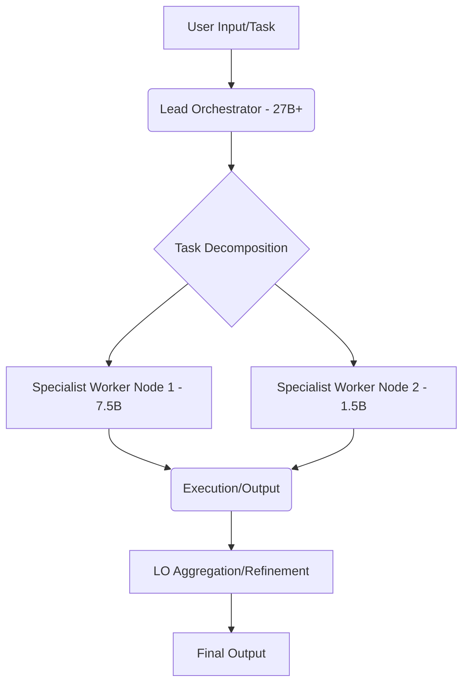
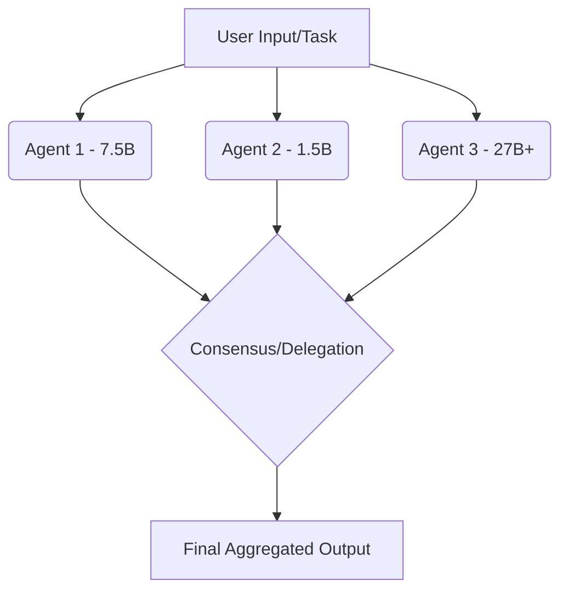

# Chapter 6: Multi-Agent Swarms & Token Economies

***

## ⚙️ Introduction: The Distributed Intelligence Paradigm

The paradigm of monolithic, centralized AI systems is rapidly giving way to a distributed, multi-agent architecture. Modern computational tasks—from complex system design and architectural planning to real-time edge inference and security validation—are too intricate and too latency-sensitive to be handled by a single, massive model.

This chapter explores the architectural blueprints for constructing resilient, economically efficient, and highly autonomous AI swarms. We move beyond simple API calls to examine the protocols, topologies, and economic directives that govern how specialized agents collaborate, arbitrate tasks, and minimize operational expenditure (OpEx) by maximizing local, offline compute.

---

## 🌐 6.1 Multi-Agent Topology: Architecting the Swarm

A multi-agent swarm is not merely a collection of models; it is a self-organizing system of specialized computational entities. The choice of topology dictates the system's resilience, latency profile, and communication overhead.

### 6.1.1 Hierarchical Swarms (The Command Structure)

In a hierarchical topology, a designated **Lead Orchestrator** (LO) manages the overall workflow, task decomposition, and resource allocation. The LO delegates specific sub-tasks to specialized **Worker Nodes** (WN).

**Characteristics:**
*   **Control:** Centralized control flow, simplifying debugging and auditing.
*   **Efficiency:** Highly efficient for complex, multi-stage workflows (e.g., "Design $\rightarrow$ Validate $\rightarrow$ Test").
*   **Bottleneck Risk:** The LO becomes a single point of failure (SPOF) and a potential latency bottleneck if overloaded.

**Application:** Ideal for system design and high-level architectural planning where a single source of truth is required.

**Diagram: Hierarchical Swarm Flow**

### 6.1.2 Peer-to-Peer Consensus Swarms (The Decentralized Mesh)

In a P2P topology, there is no single LO. All agents are peers, capable of receiving, processing, and delegating tasks. Consensus mechanisms (e.g., Byzantine Fault Tolerance variants, or simple majority voting on output) are used to resolve conflicts and ensure task completion.

**Characteristics:**
*   **Resilience:** Extremely high fault tolerance; the failure of one node does not halt the system.
*   **Complexity:** High overhead due to the necessity of consensus protocols and distributed state management.
*   **Latency:** Can suffer from increased latency due to required communication rounds for agreement.

**Application:** Ideal for real-time, distributed tasks like sensor data aggregation, distributed simulation, or adversarial testing where redundancy is paramount.

**Diagram: P2P Swarm Flow**

### 6.1.3 Specialization by Parameter Tier

The critical architectural insight is that *not all agents should perform the same function*. We must match the computational complexity of the task to the necessary model capacity.

| Parameter Tier | Typical Model Size | Primary Function | Computational Role |
| :--- | :--- | :--- | :--- |
| **Frontier/Design** | $\ge 27$ Billion (e.g., `qwen3.8:27b`) | System Architecture, High-Level Reasoning, Constraint Definition, Token Economy Policy Setting. | **Conceptualization & Abstraction** |
| **Execution/Validation** | $1.5$B - $7.5$B (e.g., `gemma4:latest`, `deepseek-r1:1.5b`) | Syntax Validation, Unit Test Execution, Local Inference, Data Filtering, Edge Processing. | **Execution & Verification** |

**Architectural Principle:** The high-parameter models define *what* must be done and *why* (the blueprint), while the quantized, lower-parameter models execute *how* it is done (the construction). This minimizes the computational cost of the most frequent operations.

---

## 💰 6.2 The Zero-Token Economy Directive

The traditional reliance on external, proprietary API services (e.g., OpenAI, Anthropic) introduces significant operational risks: variable cost, vendor lock-in, and, most critically, data leakage. The **Zero-Token Economy Directive (ZTED)** mandates that the core computational loop of the swarm operates entirely on locally hosted, self-managed infrastructure.

### 6.2.1 The Economic and Security Case for Local Compute

The ZTED is driven by three primary factors:

1.  **Cost Predictability (Zero Marginal Inference Cost):** Once the hardware (GPU cluster) is provisioned, the cost of running an additional inference is near-zero (limited only by power consumption). This contrasts sharply with cloud APIs where every token consumed incurs a direct, variable marginal cost.
    $$\text{OpEx}_{\text{Local}} \approx \text{Fixed\_Hardware\_Cost} + \text{Power\_Consumption}$$
    $$\text{OpEx}_{\text{API}} = \sum (\text{Tokens}_{\text{Input}} \times \text{Price}_{\text{Input}}) + \sum (\text{Tokens}_{\text{Output}} \times \text{Price}_{\text{Output}})$$

2.  **Data Sovereignty and Security:** By keeping the entire inference stack within a private, air-gapped, or controlled environment, sensitive data never leaves the organizational boundary. This eliminates the compliance risks associated with third-party data handling.

3.  **Latency and Reliability:** Local compute drastically reduces network latency, making real-time, high-frequency swarm interactions feasible. Furthermore, the swarm is immune to external API rate limits or service outages.

### 6.2.2 Balancing Frontier Reasoning with Edge Swarms

The ZTED does not mean abandoning state-of-the-art reasoning. It means strategically partitioning the workload:

*   **Frontier Reasoning Engines (External/Hybrid):** Used only for tasks requiring truly massive, generalized knowledge or complex, non-local data synthesis (e.g., "Analyze the geopolitical impact of this system design"). These are the expensive, high-value tasks.
*   **Local Edge Swarms (Internal/Core):** Used for the vast majority of the operational workload: code generation, syntax checking, unit test generation, data parsing, and iterative refinement. These are the high-frequency, low-cost tasks.

**The Hybrid Protocol:** The swarm uses the local agents (`qwen3.8:27b`, `gemma4:latest`, `deepseek-r1:1.5b`) as the primary processing layer. Only when the local swarm reaches a predefined complexity threshold ($\text{Complexity}_{\text{Threshold}}$) or encounters a knowledge gap beyond its training set, does it trigger a controlled, token-limited call to a frontier engine.

$$\text{Trigger}_{\text{Frontier}} = \begin{cases} \text{True} & \text{if } \text{Complexity}_{\text{Local}} > \text{Complexity}_{\text{Threshold}} \\ \text{True} & \text{if } \text{KnowledgeGap}_{\text{Local}} > \text{Tolerance}_{\text{Gap}} \\ \text{False} & \text{otherwise} \end{cases}$$

---

## 🧭 6.3 Autonomous Routing & Dynamic Arbitration

A static swarm is brittle. A truly autonomous swarm must possess a dynamic routing layer—a sophisticated control plane that determines the optimal path for a task based on real-time system state, agent capabilities, and economic constraints.

### 6.3.1 Route Override Mechanisms

The routing decision is not simply "send to the best agent," but rather a multi-criteria optimization problem. We implement three primary override mechanisms:

#### 1. Session-Based Matching (Contextual Routing)
The routing decision is tied to the current conversational or task session. If a session has already established a preference (e.g., "This design must be validated by the `gemma4:latest` agent"), the route is locked for that session, ensuring consistency and reducing arbitration overhead.

#### 2. Agent Identity-Based Matching (Capability Routing)
The task is matched to an agent based on its declared capabilities (its "skill set"). This is formalized via a capability manifest:
$$\text{Match}(\text{Task}, \text{Agent}) \iff \text{Task}_{\text{Req}} \subseteq \text{Agent}_{\text{Cap}}$$
*Example: A task requiring "Python Unit Test Generation" is routed only to agents whose manifest includes `CodeGeneration:Python`.*

#### 3. Tag-Based Matching (Dynamic Routing)
Tasks are tagged with metadata (e.g., `[Urgency: High]`, `[Security: PII]`, `[Complexity: High]`). The routing engine uses these tags to dynamically select the optimal agent pool.
*Example: A task tagged `[Security: PII]` is automatically routed to an agent running in a hardened, isolated container, regardless of its general capability.*

### 6.3.2 The AgentTrace Delegation Engine (ATDE)

The ATDE is the supervisory layer responsible for real-time, programmatic re-routing and task delegation. It acts as the swarm's nervous system, constantly monitoring the state of all active agents.

**Functionality:**
1.  **State Monitoring:** ATDE tracks metrics for every agent: $\text{Load}_{\text{Agent}}$, $\text{Latency}_{\text{Agent}}$, $\text{Resource}_{\text{Agent}}$, and $\text{SuccessRate}_{\text{Agent}}$.
2.  **Complexity Assessment:** When a task arrives, ATDE first runs a lightweight complexity classifier. This classifier estimates the computational complexity ($C$) of the task.
3.  **Dynamic Re-routing Logic:** Based on $C$, ATDE selects the optimal agent pool.

**The ATDE Decision Formula:**
The ATDE selects Agent $A^*$ that minimizes the weighted cost function $W$:
$$A^* = \arg\min_{A_i} \left( W_{\text{Latency}} \cdot \text{Latency}(A_i) + W_{\text{Cost}} \cdot \text{Cost}(A_i) + W_{\text{Load}} \cdot \text{Load}(A_i) \right)$$

Where:
*   $W_{\text{Latency}}$: Weight factor, high for real-time tasks.
*   $W_{\text{Cost}}$: Weight factor, high when ZTED is strictly enforced (prioritizing local, low-cost agents).
*   $W_{\text{Load}}$: Weight factor, high to prevent resource exhaustion (load balancing).

**Programmatic Re-routing Example:**
If the initial routing sends a task to a low-capacity agent (e.g., `deepseek-r1:1.5b`), but the ATDE detects that the task's actual complexity ($C_{\text{actual}}$) is far higher than the initial estimate ($C_{\text{initial}}$), the ATDE executes a **Route Override**. It intercepts the task, re-tags it with `[Complexity: High]`, and programmatically forwards it to the high-parameter agent pool (`qwen3.8:27b`) for deeper reasoning, effectively correcting the initial routing error mid-flight.

---

## 📚 Summary and Future Directions

The convergence of specialized agent architectures, strict economic directives, and dynamic routing mechanisms defines the next generation of AI infrastructure. By adopting the Zero-Token Economy Directive, organizations can achieve unprecedented levels of data sovereignty and cost predictability. The AgentTrace Delegation Engine provides the necessary intelligence to transform a mere collection of models into a cohesive, self-optimizing, and resilient computational swarm.

**Future Research Directions:**
1.  **Adaptive Swarm Mutation:** Developing protocols that allow agents to dynamically modify their own parameter sets or specialization tiers based on observed task distributions.
2.  **Economic Game Theory:** Implementing competitive resource allocation protocols where agents "bid" for tasks based on their current load and efficiency, formalizing the ZTED into a distributed market mechanism.
3.  **Quantum-Resilient Swarm Protocols:** Integrating post-quantum cryptography into the inter-agent communication layer to ensure long-term data integrity and security.