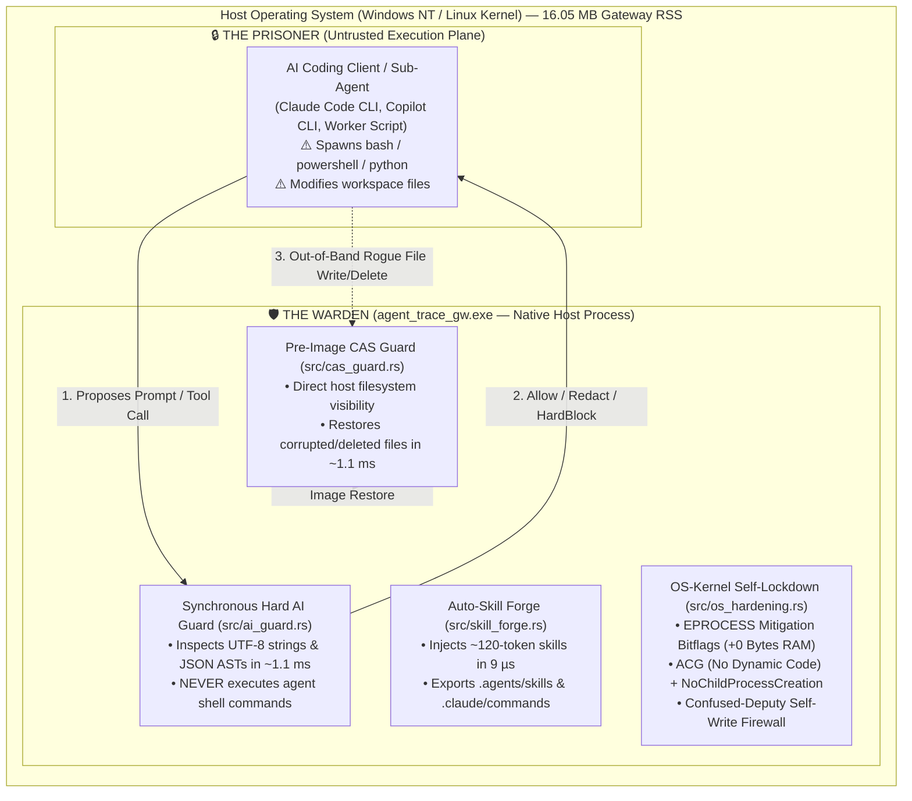

# Chapter 11: Warden vs. Prisoner Architecture — Zero-Memory OS-Kernel Self-Hardening (`src/os_hardening.rs`), Pluggable 3-Tier Persistence (`src/persistence.rs`), & Auto-Skill Forge (`src/skill_forge.rs`)

> **Learning Objectives**
> By the end of this chapter, you will understand:
> 1. **The Warden vs. Prisoner Security Principle**: Why placing a local AI runtime firewall (`agent_trace_gw`) inside a Docker container or Hyper-V/WSL2 virtual machine is an architectural anti-pattern that inflates memory from `16 MB` to `1–2 GB` while breaking `< 2 ms` host file rollback.
> 2. **Zero-Memory OS-Kernel Process Mitigations (`src/os_hardening.rs`)**: How the Windows NT Executive (`ntoskrnl.exe` `EPROCESS` mitigation bitflags) and the Linux Kernel (`prctl`) enforce **Arbitrary Code Guard (ACG / W^X)**, **No-Child-Process Creation (`NtCreateUserProcess` lock)**, **DLL Hijack & Remote UNC Blocking**, and **Ptrace/Core-Dump Protection** at **0 bytes of additional RAM**.
> 3. **Confused-Deputy Self-Write Firewalls (`WardenSelfGuard`)**: How to prevent HTTP/MCP endpoints from ever being tricked into overwriting `.secrets/`, `.ssh/`, or `.git/hooks/`.
> 4. **Pluggable 3-Tier Durable Persistence (`src/persistence.rs`)**: How Tier 1 Atomic JSON, Tier 2 SQLite WAL with SHA-256 self-healing, and Tier 3 External DB connectors work together.
> 5. **Autonomous Skill Distillation ("Auto-Skill Forge", `src/skill_forge.rs`)**: How gateway-level trajectory mining turns `~15,300-token` recurring agent failures into `~120-token` reusable skills (`99.20%` token compression).

---

## 1. The Warden vs. Prisoner Paradox: Should an AI Security Gateway Run in a Sandbox?

When engineers design security tooling, a common reflex is: *"Should we run our security gateway inside a Docker container or VM sandbox?"*

To answer that rigorously, we must first separate **who executes untrusted code (the Prisoner)** from **who enforces policy and guards the host filesystem (the Warden)**.



### 1.1 Why Container/VM Sandboxing Breaks the Warden
If you place `agent_trace_gw` inside a Docker container or WSL2/Hyper-V virtual machine on a developer workstation:
1. **You Erase the `16 MB` Memory Advantage (`35x–120x` Bloat)**:
   - Native `agent_trace_gw.exe` consumes **`~16.05 MB` of RAM RSS**.
   - Launching a Linux container on Windows/macOS spins up a lightweight VM (`vmmemWSL` / Docker Desktop LinuxKit) that immediately reserves **`600 MB to 2,000 MB` of RAM** just for the guest kernel and container daemon.
2. **You Break `< 2 ms` Host File Undo (`src/cas_guard.rs`)**:
   - [`PreImageCasGuard`](../../src/cas_guard.rs) protects host files against out-of-band corruption or deletion in **`1.12 ms` (`431 µs` live)**.
   - Inside a container/VM, accessing the host's `C:\cada\projects\...` requires crossing a virtualized filesystem bridge (`9P`, `VirtioFS`, or `drvfs`), which adds **`10x–50x` I/O latency**, strips Windows verbatim path semantics (`\\?\`), and drops native `ReadDirectoryChangesW` filesystem events.
3. **You Blind Zero-Config Agent Discovery**:
   - Host IDE agents write their transcripts to `%USERPROFILE%\.gemini\antigravity\brain\` and `%USERPROFILE%\.copilot\session-state\`. A container cannot see these paths without brittle manual volume mounts.
4. **The Gateway Never Runs Agent Shell Commands Anyway**:
   - When an AI agent proposes `rm -rf /` or `powershell -EncodedCommand ...`, `agent_trace_gw` **does not run that command**. It inspects the JSON string in memory-safe Rust and returns HTTP `403 Forbidden`.

---

## 2. Zero-Memory OS-Kernel Self-Hardening (`src/os_hardening.rs`)

If we don't put `agent_trace_gw` in a `1.5 GB` VM, how do we guarantee that **even if an attacker found a theoretical vulnerability in an HTTP parser or tried to abuse an API endpoint, `agent_trace_gw.exe` could never spawn a shell, inject shellcode, load a rogue DLL, or overwrite `.secrets/`?**

The answer lies in **OS-Kernel Process Mitigation Policies** ([`src/os_hardening.rs`](../../src/os_hardening.rs)), which are enforced directly by the operating system kernel (`ntoskrnl.exe` on Windows, `linux` kernel on Linux) at **literally `0 bytes` of extra RAM**.

### 2.1 Why Kernel Process Mitigations Cost `0 Bytes` of RAM
In the Windows NT Kernel (`ntoskrnl.exe`), every running process is represented in kernel non-paged pool memory by an `EPROCESS` executive structure. Inside `EPROCESS` (already allocated the moment any process starts) are two 64-bit bitmasks: `MitigationFlags` and `MitigationFlags2`.

When `agent_trace_gw.exe` calls the Win32 syscall `SetProcessMitigationPolicy` at startup, the kernel simply flips single bits inside the existing `EPROCESS` struct:
- **Additional processes created**: `0`
- **Additional hypervisor/VM layers**: `0`
- **Additional RAM allocated**: **`0 bytes`**

Yet once those bits are flipped in `EPROCESS`, **user-mode code cannot unset them**—the kernel itself enforces them on every subsequent system call (`NtCreateUserProcess`, `NtAllocateVirtualMemory`, `NtProtectVirtualMemory`, `NtMapViewOfSection`).

---

### 2.2 The 4 Windows NT Kernel Mitigations in `src/os_hardening.rs`

Let's examine each kernel policy implemented in [`src/os_hardening.rs`](../../src/os_hardening.rs):

#### 1. `ProcessExtensionPointDisablePolicy` (`Policy ID = 6`)
- **Kernel Bitflag**: `DisableExtensionPoints (0x0000_0001)`
- **What Attack It Stops**: Legacy Win32 extension mechanisms (`AppInit_DLLs` registry keys and `SetWindowsHookEx` global window hooks) allow third-party user-space processes to force-inject arbitrary DLLs into other processes running under the same desktop session.
- **How the Kernel Blocks It**: When `DisableExtensionPoints = 1`, the Windows loader (`ntdll.dll`) refuses to load any `AppInit` or global hook DLL into `agent_trace_gw.exe`.

#### 2. `ProcessImageLoadPolicy` (`Policy ID = 10`)
- **Kernel Bitflags**:
  - `NO_REMOTE_IMAGES (0x01)`: Blocks the kernel section mapper from loading any executable image or DLL over a remote UNC/SMB/WebDAV network share (e.g., `\\192.168.1.250\evil\payload.dll`).
  - `NO_LOW_MANDATORY_LABEL_IMAGES (0x02)`: Blocks loading any DLL that was written to disk by a Low-Integrity (sandboxed browser or untrusted sub-agent) process.
  - `PREFER_SYSTEM32_IMAGES (0x04)`: Reverses the classic Windows DLL search-order vulnerability. Even if a rogue agent drops a malicious `version.dll` or `cryptbase.dll` into the project working directory, the loader ignores the working directory and loads the authentic DLL straight from `C:\Windows\System32`.

#### 3. `ProcessDynamicCodePolicy` (`Policy ID = 2` — Arbitrary Code Guard / ACG)
- **Kernel Bitflag**: `PROHIBIT_DYNAMIC_CODE (0x0000_0001)`
- **What Attack It Stops**: In classic memory-corruption or ROP exploits, an attacker calls `VirtualAlloc` or `VirtualProtect` with `PAGE_EXECUTE_READWRITE` (`RWX`) to write shellcode into heap memory and jump to it.
- **Why Rust Binaries Love ACG**: Dynamic runtimes with JIT compilers (Node.js V8, Python C-extensions, Java JVM, .NET CLR) *cannot* easily enable ACG because their JIT engines must generate machine code in RAM at runtime. Because `agent_trace_gw.exe` is **100% Ahead-of-Time (AOT) compiled Rust**, it never generates dynamic machine code. With ACG enabled, the Windows Kernel Memory Manager (`Mm`) rejects every attempt to create executable heap pages or modify existing code pages with `STATUS_DYNAMIC_CODE_BLOCKED` (`0xC0000604`).

#### 4. `ProcessChildProcessPolicy` (`Policy ID = 13`)
- **Kernel Bitflags**: `NO_CHILD_PROCESS_CREATION (0x01)` / `AUDIT_NO_CHILD_PROCESS_CREATION (0x02)`
- **What Attack It Stops**: Remote Command Execution (RCE) via shell spawning (`cmd.exe`, `powershell.exe`, `pwsh.exe`, `curl.exe`).
- **How the Kernel Blocks It**: `agent_trace_gw.exe` is an asynchronous network proxy and SQLite ledger—it never needs to spawn child processes during normal operation. In `StrictKernelLockdown` (`AGENTTRACE_KERNEL_LOCKDOWN=true`), flipping `NO_CHILD_PROCESS_CREATION = 1` instructs `ntoskrnl.exe` (`NtCreateUserProcess`) to reject any child process creation syscall coming from `agent_trace_gw.exe`.

---

### 2.3 Linux Kernel Equivalents (`prctl`)

On Linux hosts (`#[cfg(target_os = "linux")]`), [`src/os_hardening.rs`](../../src/os_hardening.rs) models the equivalent zero-memory `task_struct` kernel flags:
1. **`prctl(PR_SET_NO_NEW_PRIVS, 1, 0, 0, 0)`**: Permanently locks the process credential state so no `setuid` binary or file capability can ever grant elevated privileges.
2. **`prctl(PR_SET_DUMPABLE, 0, 0, 0, 0)`**: Marks the process memory space as non-dumpable. This prevents another non-root process running as the same Linux user (e.g., a compromised coding agent) from attaching via `ptrace(PTRACE_ATTACH)` to read ChaCha20-Poly1305 vault keys from RAM, and prevents core dumps from writing secrets to disk.

---

### 2.4 The Confused-Deputy Self-Write Firewall (`WardenSelfGuard`)

Kernel mitigations stop binary exploitation, DLL hijacking, and shell spawning. However, what about **application-logic "Confused Deputy" attacks**?

Suppose an attacker calls an API endpoint that writes files—such as `POST /api/v1/skills/:id/export` or `POST /api/v1/rules/file`—and passes a crafted path like `../../.secrets/agenttrace.env` or `.git/hooks/pre-commit`.

In [`src/os_hardening.rs`](../../src/os_hardening.rs), [`WardenSelfGuard::verify_gateway_self_write`](../../src/os_hardening.rs#L326-L390) acts as an internal firewall around the gateway's own `std::fs::write` calls (`0.001 ms` / `1 µs` latency):
- **Explicitly Whitelisted Gateway Write Roots**:
  - `.agent_trace/` (persisted governance & skill state)
  - `.agents/skills/` and `.claude/commands/` (Auto-Skill Forge exports)
  - `logs/` (ECS 8.11 NDJSON SIEM spool)
  - `cluster_telemetry.db` and `.benchmarks_latest.json`
- **Hard-Blocked Targets (Never Writable by the Gateway)**:
  - `.secrets/`, `.ssh/`, `.env`, `.pk8`, `.pem`
  - `.git/hooks/`, `.git/config` (preventing malicious git hook persistence)
  - Any path containing `..` parent traversal
  - Any source file (`src/main.rs`, `Cargo.toml`) in `StrictKernelLockdown` mode.

---

## 3. Pluggable 3-Tier Durable Persistence (`src/persistence.rs`)

Before `v1.1.0`, custom Admin Per-Model Governance profiles, access policies, and containment zones lived in memory and reset on process restart unless manually re-applied.

In [`src/persistence.rs`](../../src/persistence.rs), [`UnifiedPersistenceManager`](../../src/persistence.rs#L462-L580) implements a **3-Tier Write-Through & Self-Healing Architecture**:

| Tier | Backend Implementation | Storage Location | Purpose & Failure Recovery |
| :---: | :--- | :--- | :--- |
| **Tier 1** | [`LocalFileBackend`](../../src/persistence.rs#L53-L142) | `.agent_trace/state/<ns>/<key>.json` | Human-inspectable, Git-friendly atomic JSON files (`json.tmp` + `fs::rename`), guarded by `WardenSelfGuard`. |
| **Tier 2** | [`SqliteKvBackend`](../../src/persistence.rs#L148-L250) | `cluster_telemetry.db` (`persistent_state` WAL table) | Stores every JSON payload alongside a **SHA-256 integrity digest** (`0.022 ms` roundtrip). **Automatically self-heals Tier 1** if a local JSON file is corrupted or truncated! |
| **Tier 3** | [`ExternalDbBackend`](../../src/persistence.rs#L275-L456) | `AGENTTRACE_DB_URL` (`postgres://`, `mysql://`, `https://`) | Optional central database synchronization. If the external DB goes offline or times out, AgentTrace **degrades gracefully to Tier 1 + Tier 2 with zero data loss**. |

---

## 4. Autonomous Skill Distillation — "Auto-Skill Forge" (`src/skill_forge.rs`)

### 4.1 Why Gateway-Level "De Facto Learning" Saves `99.20%` of Recurring Tokens
When an AI coding agent hits a project-specific build failure, PowerShell command-chaining error (`&&` vs `;`), or Admin per-model path block (`src/` vs `playground/`), it typically spends **4 to 6 conversational turns (`~15,300 tokens`)** reading compiler errors, inspecting files, and retrying until it succeeds. When the user starts a new chat session tomorrow, the agent has forgotten the lesson and burns another `15,300 tokens`.

[`SkillForgeEngine`](../../src/skill_forge.rs) solves this directly at the gateway layer:
1. **Trajectory Mining (`mine_trajectories_from_events`)**:
   - Scans the live telemetry ledger for **`ErrorRecoveryLoop`** (`Failed Command -> FileWrite Diff -> Passing Command`) and **`GuardrailCorrection`** (`Blocked Action -> Compliant Retry from Same Agent/Model`).
2. **DLP Anti-Poisoning Gate**:
   - Every candidate skill's description and markdown steps are passed through [`scan_and_redact_secrets`](../../src/ai_guard.rs) before persistence. If an agent's failed command contained an `.env` key (`sk-ant-...`), the secret is scrubbed to `[REDACTED:ANTHROPIC_API_KEY]` so credentials can never be baked into a skill.
3. **2-Tier Hybrid Scope**:
   - **`SkillScope::GlobalWorkspace`**: Shared repository lessons injected for any agent when trigger keywords match.
   - **`SkillScope::AgentOrModel(pattern)`**: Model-specific tactical lessons (e.g., `deepseek-r1:1.5b` or `claude-*`) injected only for matching models.
4. **Sub-10µs Trigger Matching & Dual Consumption**:
   - In-flight injection into `/v1/messages` and `/v1/chat/completions` takes **`0.009 ms` (`9 µs` p50)** and injects only **`~120 tokens`** (`99.20%` token reduction), with **`0` extra tokens** added to unrelated prompts.
   - `POST /api/v1/skills/:id/export` materializes skills directly to `.agents/skills/<slug>/SKILL.md` (Antigravity) and `.claude/commands/<slug>.md` (Claude Code slash command).

---

## 5. Hands-On Verification Commands

```bash
# 1. Inspect live OS-Kernel Warden Self-Hardening status (0 bytes RAM overhead):
curl -s http://localhost:8080/api/v1/security/kernel-lockdown | jq .

# 2. Dry-run a Confused-Deputy Self-Write attack against .secrets/agenttrace.env:
curl -X POST http://localhost:8080/api/v1/security/kernel-lockdown \
  -H "Content-Type: application/json" \
  -d '{"test_self_write_path": ".secrets/agenttrace.env", "test_child_spawn_exe": "powershell.exe"}'

# 3. Inspect 3-Tier Persistence status & v1.1.0 Auto-Skill Forge Token-Savings ROI:
curl -s http://localhost:8080/api/v1/persistence/status | jq .
curl -s http://localhost:8080/api/v1/skills/roi-benchmark | jq .
```
